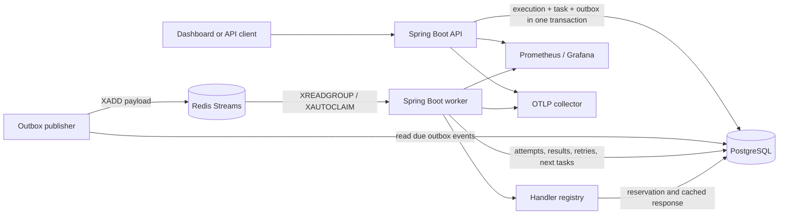
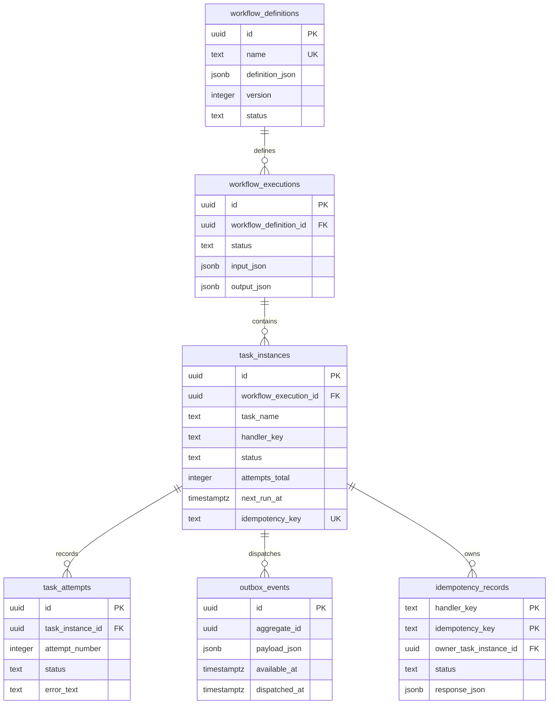

# DurableFlow Architecture (Java)

DurableFlow runs two Spring Boot roles from one Java build: an API/publisher and a worker. PostgreSQL records what should happen; Redis Streams transports task messages. The React dashboard calls the API. This is a learning-oriented workflow engine, not a hosted workflow platform.

## System View

`DURABLEFLOW_ROLE=api` enables the workflow routes and outbox loop. `DURABLEFLOW_ROLE=worker` enables the Redis consumer. Both expose `/healthz` and `/metrics`. Compose starts PostgreSQL, Redis, the collector, Prometheus, Grafana, and the dashboard alongside these roles.

## Data Model

The [SQL migrations](migrations/001_init.sql) define the exact columns and constraints. The startup migrator applies them under a PostgreSQL advisory lock so the API and worker can start against the same database safely.

## Execution Flow

1. The API validates a linear workflow definition. Triggering it inserts an execution, its entry task, and an outbox event in one PostgreSQL transaction.
2. The publisher materializes due retries into outbox rows, reads pending rows, publishes each task as the Redis `payload` field, then marks the row dispatched. A crash between publish and mark can create duplicate delivery.
3. The worker re-reads task state from PostgreSQL, locks it, and records an attempt. A succeeded or dead-lettered task is skipped; a task still marked running can receive a new attempt after reclaim.
4. The handler reserves `(handler_key, idempotency_key)` in PostgreSQL. A completed reservation returns its cached response; another task's in-progress reservation conflicts.
5. On success, one transaction completes the attempt and task, then either completes the execution or inserts the next task plus outbox event. On failure, the worker persists a retry time or terminal dead-letter state.
6. Redis messages are ACKed only after the worker returns from a durable outcome. `XAUTOCLAIM` runs before fresh group reads to recover abandoned pending messages.

## Recovery And Limits

- A retry uses `next_run_at` in PostgreSQL, not a Redis delay. Replay resets a dead-lettered task and its execution in one transaction, retaining the task ID, input, idempotency key, and accumulated attempt count.
- Delivery is at least once, not exactly once. The two demo handlers cache their responses; they do not call an external provider. A custom handler needs its own side-effect idempotency strategy.
- The source model permits overlapping attempts during recovery. There is no task lease, heartbeat, or fencing token. Outbox rows are not exclusively claimed by multiple publishers. These are known limits, not production guarantees.
- Workflows are linear, not DAGs. Definitions have a `version` column but do not yet expose a version-management API.

See [low-level design](docs/low-level-design.md) for class and sequence diagrams, [operations](docs/operations.md) for health and metrics, and [verification and limits](docs/verification.md) for test evidence and known boundaries.
