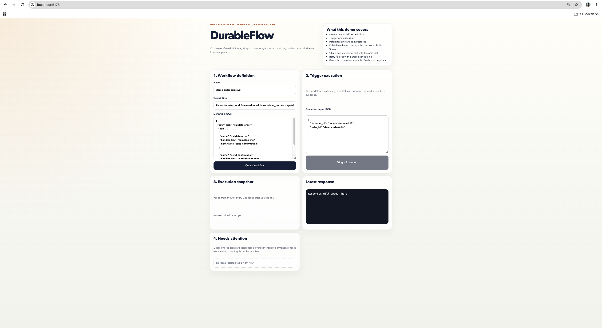
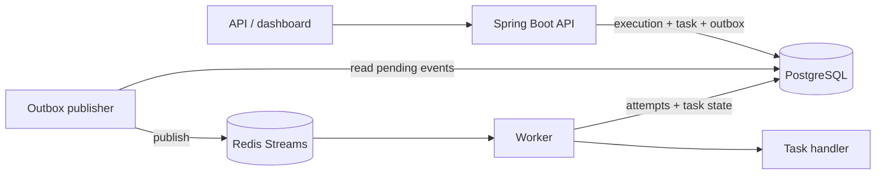

# DurableFlow

DurableFlow is a Spring Boot workflow engine for background jobs that need to survive process restarts and worker failures. It runs multi-step workflows, records each attempt in PostgreSQL, and uses Redis Streams to deliver work to workers. A React dashboard shows execution history, retries, and tasks that need attention.



## How It Works



Triggering a workflow commits the execution, its first task, and an outbox event in one database transaction. The publisher sends that event to Redis; a worker runs the handler and records the outcome. Success moves to the next step. Failure schedules a retry or dead-letters the task. If a worker disappears with a message pending, another consumer can reclaim it. Because messages may be delivered more than once, handlers use persisted idempotency records and cached responses.

## What You Can Try

| Capability | What the app does |
| --- | --- |
| Multi-step workflows | Runs a linear chain, passing one step's output to the next. |
| Durable retries | Stores attempt history and the next run time in PostgreSQL. |
| Dead-letter replay | Lists failed tasks and re-enters a selected task through the outbox. |
| Worker recovery | Reclaims abandoned Redis consumer-group messages. |
| Idempotent handlers | Reuses a completed handler response on duplicate delivery. |
| Operations view | Shows execution snapshots, attempts, and errors; Prometheus, Grafana, and OpenTelemetry provide telemetry. |

The included handlers (`sample.echo` and `notifications.send`) are demos; they do not call an external notification provider.

## Run Locally

Requires Docker and Docker Compose v2.

```bash
docker compose up --build -d
```

Open the [dashboard](http://localhost:5173), create a workflow, then trigger an execution. The API is at [localhost:8080](http://localhost:8080/healthz); the worker health endpoint is at [localhost:8081](http://localhost:8081/healthz). Grafana is at [localhost:3000](http://localhost:3000) (`admin` / `admin`). The [Postman collection](docs/postman/README.md) provides a guided API run, including dead-letter replay.

To stop the stack without deleting its PostgreSQL volume:

```bash
docker compose down
```

## Verification

```bash
mvn verify
npm --prefix apps/web ci
npm --prefix apps/web run build
```

The Java tests cover definition validation, API responses, database transactions and rollback, retry scheduling, replay, idempotency conflicts, Redis reclaim, and worker recovery. PostgreSQL and Redis integration tests use Testcontainers. GitHub Actions runs the backend tests, frontend build, and script checks on pushes and pull requests. The [benchmark driver](docs/benchmarks.md) exercises the full API-to-worker path, but this repository does not claim a measured Java throughput limit yet.

## Design Notes

- [Architecture and ER diagram](ARCHITECTURE.md): components, persistence model, and recovery boundaries.
- [Low-level design](docs/low-level-design.md): class and sequence diagrams for dispatch, retries, replay, and idempotency.
- [Execution walkthrough](docs/happy-path.md): one request traced through the Java code.
- [Operations](docs/operations.md): health checks, metrics, alerts, and troubleshooting.

Current scope: workflows are linear rather than DAGs; definitions are not version-managed through the API; running tasks have no separate lease or fencing token; and multi-publisher outbox claiming has not been stress-tested. These are documented limits, not production guarantees.
