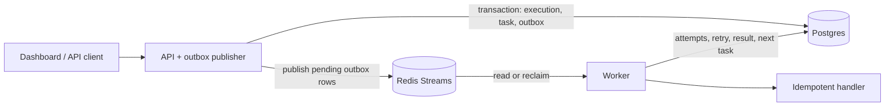

# DurableFlow

DurableFlow Java is a Spring Boot workflow engine for multi-step background jobs, using PostgreSQL, Redis Streams, and a React operations dashboard. This is an independent Java repository: it contains no Go application source or Go benchmark results. The [original Go project](https://github.com/codetitan9999/DurableWorkFlowEngine) remains separate.

**The one-minute insight:** Postgres decides what should happen; Redis delivers opportunities to do the work. Because delivery is at least once, workers re-check durable state and handlers protect side effects with persisted idempotency records.

[Architecture and ER diagram](ARCHITECTURE.md) · [LLD and class diagram](docs/low-level-design.md) · [API walkthrough](docs/postman/README.md) · [Migration status](docs/MIGRATION_PARITY.md)

## Why durable workflows are hard

A background job is straightforward until failure lands between two operations:

- the database commit succeeds but queue publication does not
- a worker performs work and crashes before acknowledging the message
- a retry is scheduled and the process restarts
- a permanently failed task needs to be repaired and replayed safely

DurableFlow handles these cases with three invariants:

1. **Postgres is authoritative.** Executions, tasks, attempts, retry times, dead-letter state, dispatch intent, and idempotency records are durable.
2. **Every dispatch uses the transactional outbox.** Initial tasks, retries, next steps, and replays all enter Redis through the same path.
3. **Duplicate delivery is expected.** Workers consult Postgres before execution; side-effecting handlers reserve durable idempotency keys.

## Architecture



A workflow run follows one durable loop:

1. The API stores an execution, its first task, and an outbox row in one transaction.
2. The publisher sends pending outbox events to a Redis consumer group.
3. A worker loads authoritative task state, records an attempt, and runs the handler.
4. Success creates the next task or completes the execution. Failure persists a future `next_run_at` or dead-letters the task.
5. A crashed worker's pending message can be reclaimed with `XAUTOCLAIM`; replay resets eligible state and re-enters through the outbox.

See the [class and flow diagrams](docs/low-level-design.md) and [data model](ARCHITECTURE.md#data-model) for interfaces, transactions, and tables.

## What is implemented

- Definition-driven, linear multi-step workflows
- Durable attempts and scheduled retries that survive restarts
- Dead-letter inspection and replay through the normal dispatch path
- Redis consumer-group recovery for stale pending messages
- Handler-level idempotency with stored successful responses
- Execution snapshots, Prometheus metrics, Grafana, and the React dashboard
- Java unit and PostgreSQL/Redis Testcontainers integration tests


## Verification

`mvn verify` runs Java unit and Testcontainers integration tests for transactions, retries, replay, idempotency, Redis reclaim, and worker recovery. Before splitting the repositories, differential smoke checks compared key HTTP and failure paths with the original Go service. The five Java benchmark scenarios have been smoke-tested, but no representative Java capacity results are claimed. See the [validation checklist](docs/MIGRATION_PARITY.md) for remaining work.

## Run locally

Prerequisites: Docker and Docker Compose v2.

```bash
cp .env.example .env
docker compose up --build
```

Then open:

- Dashboard: [http://localhost:5173](http://localhost:5173)
- API health: [http://localhost:8080/healthz](http://localhost:8080/healthz)
- Worker health: [http://localhost:8081/healthz](http://localhost:8081/healthz)
- Grafana: [http://localhost:3000](http://localhost:3000) (`admin` / `admin`)

Import the included [Postman collection and local environment](docs/postman/README.md) to create a workflow, trigger an execution, inspect its snapshot, and exercise dead-letter replay.

For a source-level check (Java 21 and Maven required):

```bash
mvn verify
npm --prefix apps/web ci
npm --prefix apps/web run build
```

Run the Java benchmark driver against the Compose API:

```bash
mvn -q compile exec:java -Dexec.mainClass=io.durableflow.bench.BenchmarkMain -Dexec.args='--scenario success-linear --executions 25 --concurrency 5 --json --output-file benchmarks/java-local.json'
```

It supports `success-linear`, `success-deep-chain`, `retry-invalid-input`, `dead-letter-missing-handler`, and `replay-missing-handler`. Results from this runner are Java-only; no Go benchmark artifacts are included here.

## Scope and tradeoffs

DurableFlow intentionally favors a clear durability model over broad workflow syntax. Chaining is linear rather than a general DAG; definitions are not versioned; long-running tasks have no separate lease or heartbeat; multi-publisher behavior has not been stress-tested; and replay lacks a richer operator audit trail.

## Go deeper

- [Architecture](ARCHITECTURE.md): current Java system, data model, and recovery limits
- [Low-level design](docs/low-level-design.md): Java class and sequence diagrams
- [Happy path](docs/happy-path.md): shortest source-guided execution trace
- [Benchmarks](docs/benchmarks.md): Java runner, scenarios, and measurement caveats
- [Operations](docs/operations.md): health checks, metrics, alerts, and incident guidance
- [Postman setup](docs/postman/README.md): runnable API happy path and replay flow
- [Migration parity](docs/MIGRATION_PARITY.md): what is verified and what remains
