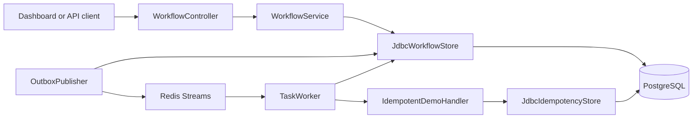
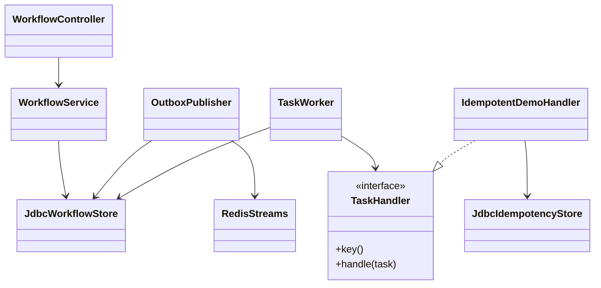

# Java architecture

This is the Spring Boot implementation. The canonical [architecture](../ARCHITECTURE.md) and [low-level design](low-level-design.md) pages contain the full current diagrams.

## Components



`DURABLEFLOW_ROLE=api` runs the REST API and outbox publisher. `DURABLEFLOW_ROLE=worker` runs the Redis consumer and task worker. Both roles expose `/healthz` and `/metrics` and apply the same PostgreSQL migrations under the original advisory lock.

## Class relationships



The store is a repository over the existing schema; the worker selects handlers by key, which is a strategy interface. Spring injects the store, Redis adapter, and handlers into the API and worker components.

## Transaction boundaries

```mermaid
sequenceDiagram
  participant A as API
  participant P as PostgreSQL
  participant O as Outbox publisher
  participant R as Redis Streams
  participant W as Worker
  A->>P: BEGIN; execution + first task + outbox; COMMIT
  O->>P: Read due retries and pending outbox
  O->>R: XADD payload
  O->>P: Mark event dispatched
  W->>R: XAUTOCLAIM, then XREADGROUP
  W->>P: Lock task and record attempt
  W->>P: Persist result, retry time, or dead letter
  W->>R: XACK only after durable outcome
```

Replay locks a dead-lettered task, clears terminal state, returns the execution to `running`, and inserts a new outbox event in one transaction. Its task ID, input, idempotency key, and accumulated attempt count remain unchanged.

For the tables and keys, see the [data model](../ARCHITECTURE.md#data-model) and [SQL migrations](../migrations/001_init.sql). For unresolved parity checks, see [MIGRATION_PARITY.md](MIGRATION_PARITY.md).
