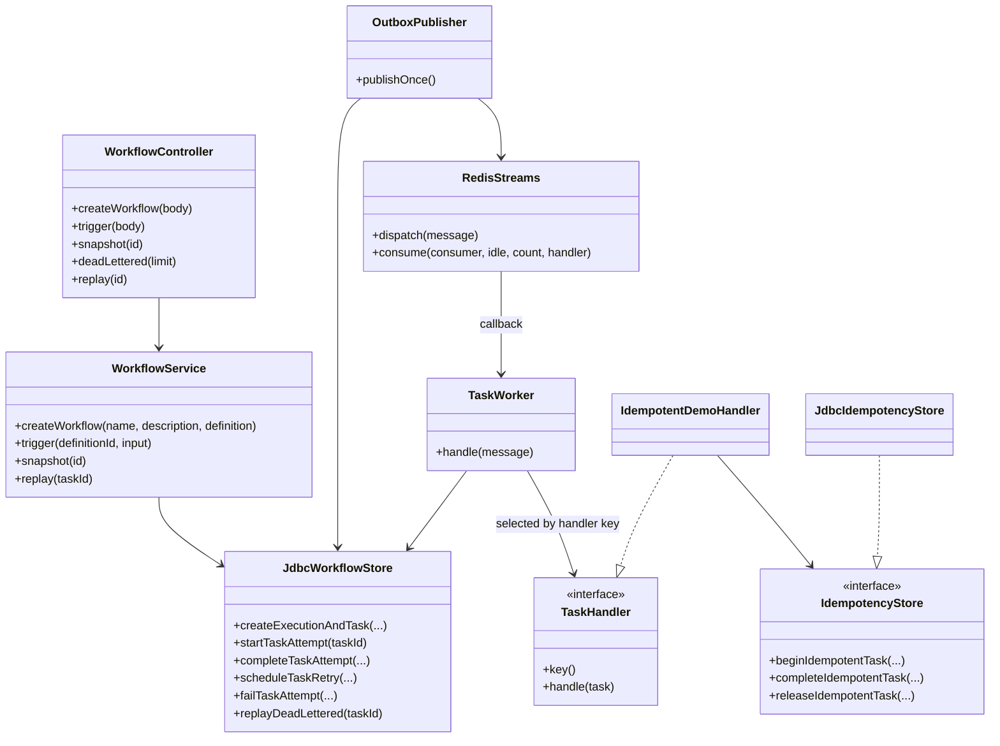

# DurableFlow Low-Level Design (Java)

The code follows repository, handler-strategy, and dependency-injection patterns. Spring wires the application roles; explicit `TransactionTemplate` boundaries keep multi-row state changes atomic. The [architecture page](../ARCHITECTURE.md) shows the system and ER diagrams.

## Class Diagram



The [domain records](../src/main/java/io/durableflow/domain/Models.java) mirror the API's snake_case JSON fields. [WorkflowDefinitions](../src/main/java/io/durableflow/domain/WorkflowDefinitions.java) validates entry and next-task references and resolves a linear chain. [DurableFlowApplication](../src/main/java/io/durableflow/DurableFlowApplication.java) creates the store, publisher, worker, and handler registry through Spring beans.

## Execution And Outbox

```mermaid
sequenceDiagram
  participant C as Client
  participant A as API/Service
  participant P as PostgreSQL
  participant O as Publisher
  participant R as Redis
  C->>A: POST /api/executions
  A->>P: BEGIN; insert execution, entry task, outbox; COMMIT
  A-->>C: 202 execution + task
  loop Poll interval
    O->>P: enqueue due retries; read pending outbox
    O->>R: XADD task payload
    O->>P: mark event dispatched
  end
```

Publishing cannot share a transaction with PostgreSQL. If Redis accepts a message but marking the outbox row fails, a later poll can publish again. The worker and handler therefore must tolerate duplicates. The outbox transaction is in [JdbcWorkflowStore](../src/main/java/io/durableflow/persistence/JdbcWorkflowStore.java); the publication order is in [OutboxPublisher](../src/main/java/io/durableflow/outbox/OutboxPublisher.java).

## Worker, Retry, And Chaining

```mermaid
sequenceDiagram
  participant R as Redis group
  participant W as TaskWorker
  participant P as PostgreSQL
  participant H as TaskHandler
  W->>R: XAUTOCLAIM then XREADGROUP
  R-->>W: task message
  W->>P: load definition and lock task; insert attempt
  alt already terminal
    W->>R: XACK duplicate
  else handler succeeds
    W->>H: handle(task)
    H-->>W: output
    W->>P: complete attempt + task; insert next task/outbox OR complete execution
    W->>R: XACK
  else retryable failure
    W->>P: mark attempt failed; persist next_run_at
    W->>R: XACK
  else terminal failure
    W->>P: mark attempt failed; dead-letter task; fail execution
    W->>R: XACK
  end
```

`max_attempts=0` means one attempt. The publisher later turns a due `next_run_at` into an outbox event using `FOR UPDATE SKIP LOCKED`. A missing handler dead-letters immediately. If task persistence fails, the consumer leaves the Redis message pending for recovery. The [worker](../src/main/java/io/durableflow/orchestrator/TaskWorker.java) owns these decisions; the [queue adapter](../src/main/java/io/durableflow/queue/RedisStreams.java) owns ACK behavior.

## Idempotency And Recovery

```mermaid
sequenceDiagram
  participant R as Redis
  participant W as Worker
  participant I as Idempotency store
  participant P as PostgreSQL
  R-->>W: message, possibly reclaimed
  W->>P: lock task; create new attempt if not terminal
  W->>I: reserve handler key + task idempotency key
  alt cached completion exists
    I-->>W: stored response
  else same owner in progress
    I-->>W: continue
    W->>I: persist successful response
  else different owner in progress
    I-->>W: conflict
  end
  W->>P: persist task outcome
  W->>R: XACK after durable outcome
```

The reservation is owned by the task, not a particular attempt. A replacement worker can resume a running task and retrieve a cached handler result after an interrupted attempt. This guards the two built-in handlers' response generation, but it does not provide exactly-once external side effects or prevent overlapping work without leases. The [combined crash-reclaim test](../src/test/java/io/durableflow/queue/WorkerCrashRecoveryIntegrationTest.java) covers the cache-and-ACK path.

## Dead Letter And Replay

```mermaid
sequenceDiagram
  participant C as Operator
  participant A as API
  participant P as PostgreSQL
  participant O as Publisher
  C->>A: POST /api/tasks/{id}/replay
  A->>P: lock task; require dead_lettered
  A->>P: reset task and execution; insert outbox; COMMIT
  A-->>C: 202 same task ID, pending
  O->>P: read outbox
```

Replay keeps the original task ID, input, idempotency key, and attempt count. A replayed missing handler will dead-letter again; replay does not repair the workflow definition. The [repository integration tests](../src/test/java/io/durableflow/persistence/JdbcWorkflowStoreIntegrationTest.java) cover replay, retry, rollback, cached output, and attempt recovery.

The [original Go implementation](https://github.com/codetitan9999/DurableWorkFlowEngine) is maintained in a separate repository.
